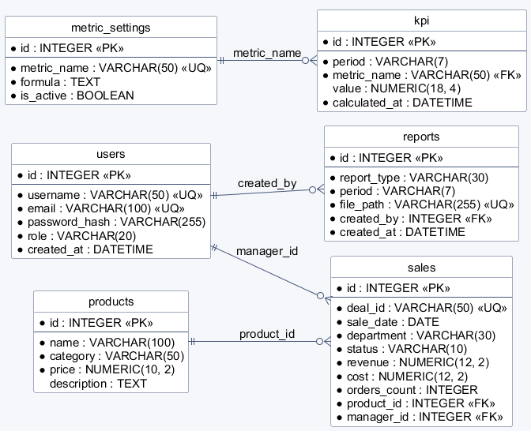

# Схема базы данных Business Metrics Analyzer

## 1. ER-диаграмма

[Исходник PlantUML](er_diagram.puml).

## 2. Таблицы

### users

| Колонка | Тип | Ограничения | Описание |
|---|---|---|---|
| id | INTEGER | NOT NULL, PK, автогенерация | Идентификатор пользователя |
| username | VARCHAR(50) | NOT NULL, UNIQUE | Логин |
| email | VARCHAR(100) | NOT NULL, UNIQUE | Электронная почта |
| password_hash | VARCHAR(255) | NOT NULL | Хеш пароля или маркер заблокированной учебной записи |
| role | VARCHAR(20) | NOT NULL | Роль из справочника ролей |
| created_at | DATETIME | NOT NULL, DEFAULT now() | Время создания |

### products

| Колонка | Тип | Ограничения | Описание |
|---|---|---|---|
| id | INTEGER | NOT NULL, PK, автогенерация | Идентификатор товара |
| name | VARCHAR(100) | NOT NULL | Название товара |
| category | VARCHAR(50) | NOT NULL | Наименование категории |
| price | NUMERIC(10, 2) | NOT NULL | Цена в рублях, неотрицательная |
| description | TEXT | NULL | Необязательное описание, добавлено в 0002 |

### sales

| Колонка | Тип | Ограничения | Описание |
|---|---|---|---|
| id | INTEGER | NOT NULL, PK, автогенерация | Идентификатор строки |
| deal_id | VARCHAR(50) | NOT NULL, UNIQUE | Внешний ключ сделки из реестра, уникальный во всём учебном наборе |
| sale_date | DATE | NOT NULL | Дата закрытия для won/lost, дата регистрации для open |
| department | VARCHAR(30) | NOT NULL | Подразделение сделки на момент регистрации |
| status | VARCHAR(10) | NOT NULL | Результат сделки: won, lost или open |
| revenue | NUMERIC(12, 2) | NOT NULL | Выручка в рублях |
| cost | NUMERIC(12, 2) | NOT NULL | Затраты в рублях |
| orders_count | INTEGER | NOT NULL | Число заказов; в CSV ПЗ‑2 одна won-сделка соответствует одному заказу |
| product_id | INTEGER | NOT NULL, FK products.id | Товар сделки |
| manager_id | INTEGER | NOT NULL, FK users.id | Менеджер сделки |

### metric_settings

| Колонка | Тип | Ограничения | Описание |
|---|---|---|---|
| id | INTEGER | NOT NULL, PK, автогенерация | Идентификатор настройки |
| metric_name | VARCHAR(50) | NOT NULL, UNIQUE | Устойчивый машинный код метрики |
| formula | TEXT | NOT NULL | Описание формулы, не исполняемый пользовательский код |
| is_active | BOOLEAN | NOT NULL, DEFAULT true | Флаг активности |

### kpi

| Колонка | Тип | Ограничения | Описание |
|---|---|---|---|
| id | INTEGER | NOT NULL, PK, автогенерация | Идентификатор результата |
| period | VARCHAR(7) | NOT NULL | Календарный месяц YYYY-MM |
| metric_name | VARCHAR(50) | NOT NULL, FK metric_settings.metric_name | Код метрики |
| value | NUMERIC(18, 4) | NULL | Значение за месяц, NULL при отсутствии знаменателя |
| calculated_at | DATETIME | NOT NULL, DEFAULT now() | Момент расчёта |

### reports

| Колонка | Тип | Ограничения | Описание |
|---|---|---|---|
| id | INTEGER | NOT NULL, PK, автогенерация | Идентификатор отчёта |
| report_type | VARCHAR(30) | NOT NULL | Тип отчёта, например xlsx |
| period | VARCHAR(7) | NOT NULL | Календарный месяц YYYY-MM |
| file_path | VARCHAR(255) | NOT NULL, UNIQUE | Уникальный ключ объекта в хранилище |
| created_by | INTEGER | NOT NULL, FK users.id | Автор отчёта |
| created_at | DATETIME | NOT NULL, DEFAULT now() | Время создания |

### Ограничения предметной области

- Роли users: director, manager, analyst, admin. Демо-продажи ссылаются на менеджеров. FK гарантирует существование пользователя, его роль проверяет слой приложения.
- Цена, выручка и затраты неотрицательны. У won число заказов положительно. У lost и open число заказов, выручка и затраты равны нулю. Отрицательная маржа для won допустима.
- Пара `(period, metric_name)` уникальна. Кэш ПЗ‑5 хранит один агрегат на месяц и метрику по всему учебному набору.

## 3. Связи и нормализация

| Родитель | Потомок | Кардинальность | Внешний ключ |
|---|---|---|---|
| users | sales | 1 : 0..N | sales.manager_id → users.id |
| products | sales | 1 : 0..N | sales.product_id → products.id |
| users | reports | 1 : 0..N | reports.created_by → users.id |
| metric_settings | kpi | 1 : 0..N | kpi.metric_name → metric_settings.metric_name (UNIQUE) |

Все внешние ключи обязательны. СУБД запрещает удаление родителя при наличии дочерних строк.

**1НФ.** Значения атомарны, каждая строка имеет первичный ключ. **2НФ.** Неключевые поля зависят от полного ключа. У результата KPI с составным альтернативным ключом значение и время расчёта относятся к паре «месяц и метрика». **3НФ.** Данные пользователей, товаров и формулы хранятся в родительских таблицах. Месяц продажи вычисляется из даты. Категория пока представлена одним наименованием без собственных атрибутов. Подразделение фиксируется в сделке и сохраняет исторический смысл при переводе менеджера.

### Связь с предыдущими практиками

- [Требования](../business_requirements.md), [User Stories](../user_stories.md) и [backlog](../product_backlog.md): FR-01/02 и US-01 опираются на агрегаты, FR-03 и US-02 на ключ сделки и целостность, FR-05/06 и US-04/05 на метаданные отчёта.
- [Архитектура ПЗ‑4](https://github.com/ravaaaa1/business-metrics-analyzer/pull/5): SQLite используется как учебная СУБД, целевая архитектура предусматривает PostgreSQL. Шесть таблиц описывают объём ПЗ‑5. Версии импорта, область доступа, журнал и рабочие задания относятся к развитию веб-версии. Запросы демонстрации выполняются по всему синтетическому набору.
- Средний чек = сумма выручки / сумма заказов. Конверсия = won / (won + lost) × 100. Рентабельность = (выручка − затраты) / выручка × 100. Open не участвуют. При отсутствии знаменателя результат NULL.

## 4. Индексы

| Таблица | Индекс | Назначение |
|---|---|---|
| sales | ix_sales_sale_date_id | Диапазон дат и стабильная сортировка в пределах месяца |
| sales | ix_sales_manager_id, ix_sales_product_id | Связи с менеджером и товаром |
| reports | ix_reports_created_by | Отчёты автора и проверка FK |
| kpi | ix_kpi_metric_name | Запросы по коду метрики и проверка FK |
| kpi | uq_kpi_period_metric | Уникальность результата и поиск по месяцу |

PK и остальные ограничения UNIQUE также поддерживаются индексами СУБД.

## 5. Миграции

| Ревизия | Изменение | Дата выполнения работы |
|---|---|---|
| 0001 | Шесть таблиц, ограничения, внешние ключи и индексы | 19.11.2026 |
| 0002 | Необязательное поле products.description | 19.11.2026 |

Обе ревизии получены через `alembic revision --autogenerate`. Для отката 0002 нужен SQLite 3.35+ (DROP COLUMN). Откат удаляет описание товаров. Результаты проверок и команды запуска описаны в [README ПЗ‑5](README.md).
